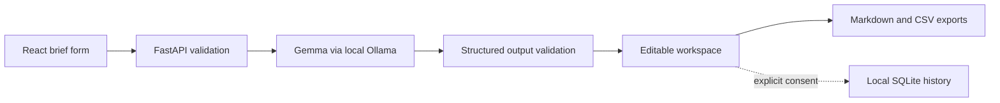

# ---
title: "FreelanceFlow AI: Turn a Rough Client Brief into a Real Freelance Plan"
published: false
tags: devchallenge, hf26challenge
---

*This is a submission for the [Hacktoberfest Open-Source AI Challenge Week 2: Side Hustle](https://dev.to/challenges/hacktoberfest-week2-2026-10-12)*

## What I Built

Freelancers often receive a paragraph of requirements and are expected to turn it into a proposal, scope, timeline, price, and invoice before the next meeting. That translation work is repetitive, easy to under-specify, and often involves sensitive client information.

I built **FreelanceFlow AI**, a local-first React and FastAPI web app that turns a rough client brief into editable drafts. The original Streamlit implementation is preserved as a legacy interface:

- client brief analysis: objectives, deliverables, assumptions, missing information, and risks
- a professional proposal
- a scope of work with acceptance criteria and out-of-scope work
- milestones with durations, dependencies, and review checkpoints
- a transparent estimate using the freelancer's own rate, hours, and costs
- a clearly labelled invoice draft with a locally generated reference
- Markdown, text, and CSV exports

## Demo

Run the backend and frontend locally, open `http://localhost:5173`, click **New project**, load the demo bakery brief, and click **Analyze brief**. Then generate and edit the proposal, scope, milestones, pricing estimate, and invoice draft. The local walkthrough is reproducible from the repository; a public deployment is not claimed yet.

Demo link: _[ADD A VERIFIED DEPLOYED APP URL HERE, OR STATE THAT THE REPOSITORY-BASED LOCAL DEMO IS THE AVAILABLE DEMONSTRATION]_
The challenge template accepts either a deployed link or a video demo. I am not providing a video; this placeholder must be replaced only after a working deployment has been verified.

## Code

Repository: [FreelanceFlowAI on GitHub](https://github.com/shrey04kaitke-sys/FreelanceFlowAI)

## How I Built It

The app uses a React + TypeScript + Vite frontend, a FastAPI + Pydantic backend, SQLite for explicitly saved local history, and Ollama for local inference. There are no paid API keys or cloud AI services in the implemented application.

Gemma is the default model through Ollama (`gemma3:1b`, 806 MB in this environment). Qwen (`qwen2.5:3b`) remains an optional fallback. The backend detects installed models and reports the actual model used for each generated artifact in the workspace.

Gemma extracts goals, requirements, deliverables, constraints, assumptions, missing information, and risks from rough briefs. It also generates structured proposals, scopes, milestones, and invoice drafts. Pydantic/request validation and application-level required-field validation reject malformed output before it is shown as export-ready. If a model omits a required field, the backend marks it explicitly as `TBD` rather than inventing a commitment, then validates the normalized response.

Pricing arithmetic is deterministic Python using only user-supplied rates, hours, and direct costs. Invoice documents remain labelled `DRAFT` and are not tax-compliant invoices.

### What I tested

- 17 backend and legacy tests pass with mocked Ollama failure cases.
- Frontend TypeScript validation and production build pass.
- Real FastAPI-to-Ollama analysis passed with `gemma3:1b`.
- Gemma and Qwen both produced validator-accepted output for three fixed synthetic briefs.
- The frontend browser flow reached the editable workspace and loaded a real generated analysis.

## Why Does Open Innovation Matter?

Client briefs can contain sensitive project information. Local inference avoids sending those briefs to a paid cloud AI API and avoids per-request cloud AI charges, while open-weight models make the workflow inspectable and runnable without a vendor account. The app still depends on local Ollama and the user's operating environment; it is not claimed to be completely offline. The tradeoff is that users must provide their own hardware and review model output.

The current implementation is designed for local use rather than a generic cloud deployment: the backend calls Ollama on the local machine, and optional history is stored in a local SQLite database. The history API has no authentication and is documented for loopback-only use, so I will not expose it publicly without adding authentication and per-user authorization. A hosted demo would need a separately secured deployment architecture and an inference host capable of running Gemma.

## My First User

_Add this section only after a real person has tried the project. No first-user feedback has been collected yet._

## Prize Categories

I am entering **Best Use of Gemma** because Gemma is implemented as the default local inference model, performs the core brief-analysis and document-generation workflows, is validated through the real Ollama API, and is shown as model provenance in the workspace. Qwen remains a fallback, not a substitute for the Gemma integration.

No other prize category is claimed.

## Before publishing

- Verify and add a working deployed app link, or keep the local-demo limitation explicit. No video demo is being supplied.
- Replace the first-user placeholder with actual feedback, or remove the section.
- Confirm the challenge deadline, eligibility, tags, and template immediately before publishing.
- Review the AI disclosure and ensure no client information appears in the post or screenshots.
